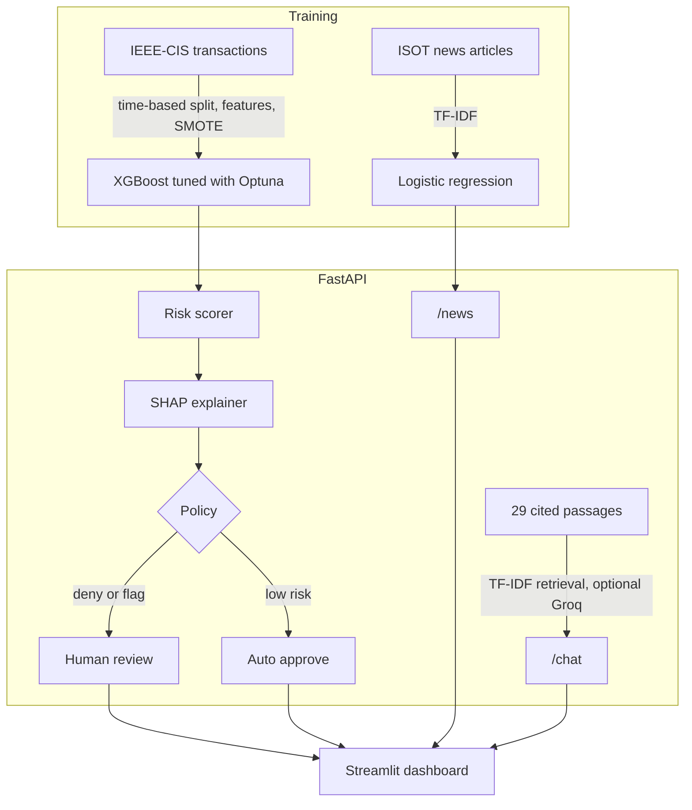

# Agentic Fraud Sentinel

Card fraud detection on the IEEE-CIS dataset. An XGBoost model scores each transaction, SHAP explains the score, and a LangGraph workflow decides whether to approve it, deny it or send it to a human reviewer. The same API also screens news articles for likely fake content and answers questions about card fraud and fake news from cited sources.

- API docs: [agentic-fraud-sentinel.onrender.com/docs](https://agentic-fraud-sentinel.onrender.com/docs)
- Dashboard: [agentic-fraud-sentinel.streamlit.app](https://agentic-fraud-sentinel.streamlit.app/)

## How it works



A transaction goes through LangGraph nodes that share one typed state. The risk scorer gets the fraud probability from XGBoost. The explainer adds the top SHAP contributions, each with its value, size and direction. The policy node then applies these rules, and the graph routes the case to human review or auto-approval before a report node writes the final record:

| Condition | Decision | Human review |
| :-------- | :------- | :----------: |
| Fewer than half of the 446 model features supplied | flag | yes |
| Probability at or above the threshold (0.0958) | deny | yes |
| Probability between half the threshold and the threshold | flag | yes |
| Probability below half the threshold | approve | no |

The API prepares each transaction the way training did: frequency maps, training medians and category codes fitted on the training period ship inside the model bundle, and the time and missingness features are derived from the raw fields. A field sent as `null` counts as supplied but missing, as it was in training. History features such as a card's recent transaction counts need the card's past transactions, so a caller without them gets the training median. That is why the first rule exists: a request with only a handful of fields gets a score that rests mostly on medians. The policy is kept apart from training: `POLICY_MIN_FEATURE_COVERAGE` (default 0.5) and `POLICY_MEDIUM_RISK_FRACTION` (default 0.5) change the rules without retraining.

## Features

| Feature | What it does |
| :------ | :----------- |
| Fraud model | XGBoost on 590,540 IEEE-CIS transactions, split by time so the test set is the newest 20%. Features include hour of day, missing-value flags, frequency encodings per-card transaction counts and amounts over the last hour and day, and the seconds since the same card's previous transaction. SMOTE raises the fraud share in training from 3.4% to 9.1%. Optuna tunes the model on a validation slice, and the decision threshold is picked on that slice too. |
| Explanations | TreeSHAP gives the features that pushed each score up or down, with the feature value, SHAP contribution and direction. |
| Decision workflow | LangGraph routes each transaction to approve, deny or human review using the rules above. |
| Review queue | A case that needs a human pauses the LangGraph run before the human review node, and its state is saved by a checkpointer. `/predict` answers straight away with the case marked as awaiting review. When an analyst approves or denies it through `POST /reviews/{id}`, the decision is written into the saved state and the run resumes through human review and the report node, which returns the final report. The time each case waited is recorded. |
| Monitoring | Each prediction is logged with its ID, latency, probability, decision and model version. `GET /stats` reports request volume, error rate, p50/p95/p99 latency, decision rates, the review queue, drift (PSI against the training period) for the ten raw numeric fields that rank highest by SHAP and for the model's scores, and alerts when any of these crosses a limit. With `MONITOR_LOG_PATH` set, every prediction and review goes to a JSON-lines file, and the stats and review queue are rebuilt from it after a restart. Analyst decisions give the share of reviewed cases that were fraud. When the true outcome arrives later (a chargeback, or none), `POST /feedback/{id}` attaches it, and `/stats` reports the model's live precision, recall and false-positive rate on that labelled traffic. |
| Experiment log | Every evaluation is appended to `model_log.json` with its metrics, parameters, dataset, timestamp and Git commit. |
| News screening | `POST /news` labels an article *likely fake*, *likely real* or *uncertain* with TF-IDF and logistic regression trained on the ISOT Fake and Real News dataset. Scores between 0.35 and 0.65 are reported as uncertain, and texts under 30 words are not scored. It judges writing style only and does not check facts. |
| Fraud and news assistant | `POST /chat` answers from 29 passages taken from FactCheck.org, UC Berkeley Library, USAGov and Wikipedia, and cites them as [1], [2]. When no passage matches, it asks the user to rephrase. If `GROQ_API_KEY` is set, Groq (`openai/gpt-oss-120b` by default, change it with `GROQ_MODEL`) writes the reply from the retrieved passages only. Without a key, or if the call fails, it returns the passages. |
| Dashboard | Streamlit page with model metrics, a live transaction tester, news screening, the assistant, live monitoring and the review queue. |

## Results

### Fraud model

| Model | AUC-ROC | AUC-PR | Precision | Recall | F1 |
| :---- | :-----: | :----: | :-------: | :----: | :-: |
| XGBoost baseline | 0.8925 | 0.4959 | 0.7783 | 0.3196 | 0.4532 |
| Optuna-tuned XGBoost | 0.8875 | 0.5110 | 0.8022 | 0.3233 | 0.4609 |
| Tuned, threshold 0.0958 from validation | 0.8875 | 0.5110 | 0.5480 | 0.4722 | 0.5073 |

The same run compared imbalance handling and model families, each at a 0.5 cutoff:

| Model | AUC-ROC | AUC-PR | Precision | Recall | F1 |
| :---- | :-----: | :----: | :-------: | :----: | :-: |
| XGBoost, SMOTE | 0.8925 | 0.4959 | 0.7783 | 0.3196 | 0.4532 |
| XGBoost, class weighting (`scale_pos_weight`) | 0.8725 | 0.4744 | 0.2511 | 0.6046 | 0.3548 |
| LightGBM, SMOTE | 0.8931 | 0.4942 | 0.7443 | 0.3403 | 0.4671 |

SMOTE beats class weighting on both AUC scores, and LightGBM is level with XGBoost, so the shipped model stays XGBoost with SMOTE. The previous model, trained without the time-since-previous feature, scored 0.8974 AUC-ROC and 0.5174 AUC-PR on the same test set, a little higher; this one has a slightly higher F1 at its threshold (0.5073 against 0.5063).

Every row is scored once on the newest 20% of transactions (118,108 rows). Imputation, frequency maps, tuning and the threshold use training data only, and the newest 20% of the training period is held out as validation before SMOTE. [`notebooks/colab_retrain.ipynb`](notebooks/colab_retrain.ipynb) reproduces the run, and each run is logged in [`model_log.json`](notebooks/data/model_results/model_log.json).

From the data and the model:

- The fraud rate moves between 2.0% and 4.8% across the 182 days of transactions.
- 214 features are more than half missing, and each gets a flag column.
- `TransactionAmt` on its own separates fraud poorly.
- By mean SHAP value on 5,000 test rows, raw fields lead: `C13`, `V317`, `TransactionAmt`, `C1` and `M4`. The card frequency count `card1_freq` ranks sixth, and 4 of the top 20 features are engineered: `card1_freq`, `tx_hour`, `card2_freq` and `P_emaildomain_freq`. The time since the previous transaction is not in the top 20. [`shap_top_features.csv`](notebooks/data/model_results/shap_top_features.csv) has the full list, and the last cells of the retrain notebook reproduce it.

### Live replay with real outcomes

`scripts/build_inference_artifacts.py` rebuilds the training preprocessing from the raw Kaggle files and checks it: scored through the rebuilt steps, the test period gives 0.8876 AUC-ROC and 0.5111 AUC-PR against the saved 0.8875 and 0.5110, and preparing transactions one at a time the way the API does gives the same scores as the batch pipeline.

`scripts/replay_labelled.py` then sent 1,000 randomly drawn test-period transactions, raw fields only, through a locally running API and reported each true outcome to `/feedback`. This is what `/stats` showed:

| Labelled | Fraud | Precision | Recall | False-positive rate | Approved | Sent to review |
| :------: | :---: | :-------: | :----: | :-----------------: | :------: | :------------: |
| 1,000 | 35 | 0.500 (14 of 28) | 0.400 (14 of 35) | 0.0145 | 94.9% | 5.1% |

With 35 fraud cases the uncertainty is wide, so these numbers are in line with the test-set 0.548 precision and 0.472 recall rather than a separate estimate. Latency on a laptop was 447 ms at p50 and 1,223 ms at p95, mostly SHAP.

### News classifier

Trained on ISOT, 38,010 articles after removing duplicates and texts under 30 words, with a stratified 80/20 split.

| Accuracy | F1 | AUC-ROC | Scored as uncertain | Accuracy outside the uncertain band |
| :------: | :-: | :-----: | :-----------------: | :---------------------------------: |
| 0.9828 | 0.9804 | 0.9984 | 3.1% | 0.9933 |

Every real ISOT article comes from Reuters, so the Reuters byline, image credits, links and handles are stripped before training to stop the model learning the publisher. These are still in-dataset scores, and accuracy on other outlets and years will be lower.

## Tech stack

| Area | Tools |
| :--- | :---- |
| Data | `pandas`, `numpy`, `scikit-learn` |
| Class imbalance | `imbalanced-learn` (SMOTE) |
| Models | `XGBoost`, `LightGBM` (comparison), `scikit-learn` logistic regression |
| Tuning | `Optuna` on a time-ordered validation slice |
| Explanations | `SHAP` |
| Workflow | `LangGraph`, SQLite checkpoints for paused runs |
| Text and retrieval | `scikit-learn` TF-IDF, Groq API (optional) |
| API | `FastAPI`, `uvicorn` |
| Dashboard | `Streamlit`, `Plotly`, `Matplotlib` |
| Testing and CI | `pytest`, `ruff`, GitHub Actions |
| Deployment | `Docker`, Render, Streamlit Community Cloud |

## API

| Method | Path | Returns |
| :----- | :--- | :------ |
| GET | `/health` | Service status |
| POST | `/predict` | Fraud probability, risk level, decision, SHAP explanation and policy reasoning |
| GET | `/metrics` | Test metrics and threshold of the shipped fraud model |
| GET | `/stats` | Live volume, latency, decision rates, drift, review queue and alerts |
| POST | `/feedback/{transaction_id}` | Attach the true outcome (`is_fraud`) to a recent prediction |
| GET | `/reviews` | Cases waiting for an analyst |
| POST | `/reviews/{transaction_id}` | Record an analyst's approve or deny, resume the paused run and return its final report |
| POST | `/news` | News label, fake probability and a note |
| GET | `/news/metrics` | Test metrics of the news classifier |
| POST | `/chat` | Answer, cited sources, topic and whether Groq wrote it |

## Project structure

```text
Agentic-Fraud-Sentinel/
├── api/
│   └── main.py               # FastAPI service
├── dashboard/
│   └── app.py                # Streamlit dashboard
├── data/
│   ├── raw/                  # IEEE-CIS and ISOT source files (not committed)
│   └── processed/            # Split and balanced data (not committed)
├── notebooks/
│   ├── eda.ipynb             # Exploratory data analysis
│   ├── preprocessing.ipynb   # Feature pipeline
│   ├── model.ipynb           # Training and Optuna tuning
│   ├── shap.ipynb            # SHAP analysis
│   ├── graph.ipynb           # LangGraph workflow
│   ├── api.ipynb             # API walkthrough
│   ├── colab_retrain.ipynb   # Full retrain on a Colab GPU
│   └── data/models/          # Shipped models
├── scripts/
│   ├── build_inference_artifacts.py  # Rebuild training preprocessing for the API
│   └── replay_labelled.py            # Send real labelled transactions to a running API
├── src/
│   ├── agents/               # LangGraph state, nodes and graph
│   ├── chat/                 # Retrieval assistant and its source passages
│   ├── data/                 # Features and preprocessing
│   ├── explainability/       # TreeSHAP helpers
│   ├── models/               # Training and evaluation
│   ├── monitoring.py         # Request log, stats, drift, review queue
│   └── news/                 # News classifier
├── tests/                    # pytest suite
├── Dockerfile
└── requirements.txt
```

## Setup

```bash
git clone https://github.com/Shashank17singh/Agentic-Fraud-Sentinel.git
cd Agentic-Fraud-Sentinel
python -m venv venv
source venv/bin/activate      # Windows: venv\Scripts\activate
pip install -r requirements.txt
```

The trained models are in the repo, so the API runs without the datasets. To retrain, download the data first:

- Fraud: [IEEE-CIS Fraud Detection](https://www.kaggle.com/c/ieee-fraud-detection). Put `train_transaction.csv` and `train_identity.csv` in `data/raw/`, then run [`notebooks/colab_retrain.ipynb`](notebooks/colab_retrain.ipynb), ideally on a GPU.
- News: [Fake and Real News](https://www.kaggle.com/datasets/clmentbisaillon/fake-and-real-news-dataset). Put `Fake.csv` and `True.csv` in `data/raw/isot/`, then run `python -m src.news.classifier data/raw/isot`.

Start the API:

```bash
uvicorn api.main:app --host 0.0.0.0 --port 8000 --reload
```

Optional environment variables:

| Variable | Effect |
| :------- | :----- |
| `GROQ_API_KEY` | Lets Groq write the assistant's replies. Keep it out of git. |
| `GROQ_MODEL` | Groq model, default `openai/gpt-oss-120b` |
| `POLICY_MIN_FEATURE_COVERAGE` | Share of model features a request must supply before the policy decides, default 0.5 |
| `POLICY_MEDIUM_RISK_FRACTION` | Fraction of the threshold where medium risk starts, default 0.5 |
| `CHECKPOINT_DB_PATH` | Keep paused review runs in this SQLite file, so they can still resume after a restart. Without it they live in memory. |
| `MONITOR_LOG_PATH` | Append every prediction and review to this JSON-lines file, and rebuild stats from it on start |

The input drift references in `notebooks/data/models/drift_reference.json` come from `python -m src.monitoring data/raw/train_transaction.csv`. The retrain notebook adds the reference for model scores.

Start the dashboard in a second terminal:

```bash
streamlit run dashboard/app.py
```

## Tests

```bash
pytest
ruff check .
ruff format --check .
```

CI runs the same three commands on Python 3.10 for every push. A second job builds the Docker image, starts it and calls `/health`, `/predict` and `/stats` inside it. Requirements are pinned to exact versions.

## Deployment

```bash
docker build -t agentic-fraud-sentinel .
docker run -p 8000:8000 agentic-fraud-sentinel
```

The image holds the API and the shipped models. The dashboard is deployed separately on Streamlit Community Cloud and calls the API on Render.

## Limitations

- SHAP adds compute to every prediction, so high-volume use would need the explanations computed in the background.
- Fraud patterns drift. The model needs periodic retraining and checking against recent transactions.
- The news classifier only learns writing style from one dataset. A false story written in wire-service style can be labelled likely real.
- The assistant knows only its 29 passages. Without Groq, an off-topic question that shares a common word with a passage can still get an answer from that passage.
- Stats cover the last 1,000 requests. They survive a restart only with `MONITOR_LOG_PATH` on a disk that persists. Render's free disk is wiped on each deploy, so the live stats reset there.
- Score drift appears only after the retrain notebook has saved its reference. Live precision, recall and false-positive rate need true outcomes sent to `/feedback`. Real chargebacks arrive weeks later; the replay below stands in for them with the dataset's own labels.
- Without `CHECKPOINT_DB_PATH`, paused runs live in memory. After a restart the analyst's decision is still recorded, but the run cannot resume, so no final report comes back. On Render's free tier even the SQLite file is wiped on each deploy.
- The alert limits are common defaults, not tuned on real traffic.

## License

MIT. See [LICENSE](LICENSE).
