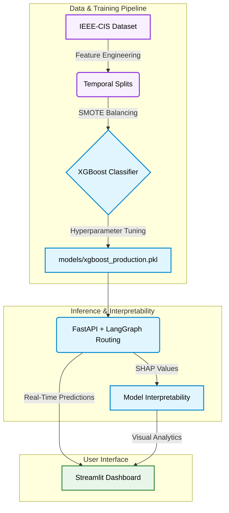

# Agentic Fraud Sentinel

A fraud detection system that pairs an XGBoost classifier with a LangGraph decision workflow, SHAP explanations and a FastAPI backend.

> **Live Deployments:**
> * **Interactive API Documentation:** [agentic-fraud-sentinel.onrender.com/docs](https://agentic-fraud-sentinel.onrender.com/docs)
> * **Streamlit Monitoring Dashboard:** [agentic-fraud-sentinel.streamlit.app](https://agentic-fraud-sentinel.streamlit.app/)

---

## Overview

Agentic Fraud Sentinel protects payment rails by pairing machine learning classification with agentic decision workflows. Built on a tuned XGBoost model, the system leverages engineered temporal features to capture evolving user behavior, SMOTE to address severe class imbalance, and SHAP attribution values to explain every prediction. A LangGraph workflow scores incoming transactions, computes feature contributions, applies institutional policy guardrails, and routes ambiguous edge cases to human investigators.

---

## Architecture Overview



The platform processes the IEEE-CIS Dataset (590k transactions) through a multi-stage data and evaluation pipeline.

---

## Features

| Feature | Description |
| ------- | ----------- |
| **Data & Feature Engineering** | Time-based splitting (by `TransactionDT`) to simulate real-world data drift. Implements rolling aggregates, frequency encoding, missingness flags, and SMOTE to balance fraud representation (3.5% to 10%). |
| **Agentic Decision Core** | XGBoost classifier tuned via Optuna. Inference requests are routed intelligently via LangGraph agents to determine whether transactions are approved, declined, or escalated to human review. |
| **Interpretability Layer** | TreeSHAP (SHapley Additive exPlanations) generates per-prediction feature attribution for transparent audit trails. |
| **Dual Serving Stack** | Containerized FastAPI backend (`/predict`) powered by LangGraph, paired with a real-time Streamlit operations dashboard. |
| **News Screening** | `POST /news` gives a preliminary *likely fake*, *likely real* or *uncertain* label from TF-IDF and logistic regression trained on the ISOT Fake and Real News dataset. Texts under 30 words are not scored. It judges writing style only and does not check facts. |
| **Fraud and News Assistant** | `POST /chat` answers questions on card fraud and fake news from 29 passages taken from FactCheck.org, UC Berkeley Library, USAGov and Wikipedia, with numbered citations. When no passage matches it asks the user to rephrase instead of guessing. With `GROQ_API_KEY` set, Groq (`openai/gpt-oss-120b` by default, override with `GROQ_MODEL`) writes the reply from the retrieved passages only; without a key, or if the call fails, it returns the passages themselves. |

---

## Model Performance Metrics

| Optimization Stage | AUC-ROC | AUC-PR | Precision | Recall | F1 Score |
| :----------------- | :-----: | :----: | :-------: | :----: | :------: |
| **XGBoost Baseline** | 0.8925 | 0.4956 | 0.7917 | 0.3105 | 0.4461 |
| **Optuna Tuned XGBoost** | 0.8974 | 0.5174 | 0.8100 | 0.3295 | 0.4684 |
| **Validation Threshold** (0.1885) | 0.8974 | 0.5174 | 0.5774 | 0.4508 | 0.5063 |

All rows are scored once on the last 20% of transactions by time (118,108 rows). Imputation, frequency maps, Optuna tuning and the threshold all use training data only: the newest 20% of the training period is held out as validation before SMOTE. [`notebooks/colab_retrain.ipynb`](notebooks/colab_retrain.ipynb) reproduces the run, and every run is logged in [`model_log.json`](notebooks/data/model_results/model_log.json).

**Exploratory Data Analysis (EDA) Highlights:**
- Fraud rate is non-stationary, varying between 2.0% and 4.8% across the 185-day transaction window.
- 214 high-cardinality features with >50% missingness are tracked via explicit indicators.
- `TransactionAmt` alone provides weak discrimination.
- By mean SHAP value on 5,000 test rows, the transaction hour (`tx_hour_sin`) ranks fifth, and 5 of the top 20 features are engineered: three hour features plus the card and email-domain frequency counts. Raw Vesta fields such as `C13`, `M4` and `V317` lead the ranking. The last cells of the retrain notebook reproduce this.

**News classifier** (ISOT, 38,010 articles after removing duplicates and texts under 30 words; stratified 80/20 split):

| Accuracy | F1 | AUC-ROC | Scored as uncertain | Accuracy outside the uncertain band |
| :------: | :-: | :-----: | :-----------------: | :---------------------------------: |
| 0.9828 | 0.9804 | 0.9984 | 3.1% | 0.9933 |

Every real ISOT article comes from Reuters, so the Reuters byline, image credits, links and handles are stripped before training to stop the model learning the publisher. The scores are still in-dataset; expect lower accuracy on news from other outlets and periods. Retrain with `python -m src.news.classifier data/raw/isot` after downloading the [dataset](https://www.kaggle.com/datasets/clmentbisaillon/fake-and-real-news-dataset) into `data/raw/isot/`.

---

## Technology Stack

| Component | Technologies |
| :-------- | :----------- |
| **Data Processing** | `pandas`, `numpy`, `scikit-learn` |
| **Imbalanced Learning** | `imbalanced-learn` (SMOTE) |
| **Machine Learning** | `XGBoost`, `Scikit-learn` |
| **Hyperparameter Tuning** | `Optuna`, TimeSeriesSplit Cross-Validation |
| **Interpretability** | `SHAP` |
| **Agentic Workflow** | `LangGraph`, `LangChain` |
| **Text & Retrieval** | `scikit-learn` TF-IDF, logistic regression, Groq API (optional) |
| **API & Serving** | `FastAPI`, `uvicorn` |
| **Frontend & Analytics** | `Streamlit`, `Matplotlib`, `Plotly` |
| **Testing & CI** | `pytest`, `ruff`, GitHub Actions |
| **Containerization** | `Docker` |

---

## Project Structure

```
Agentic-Fraud-Sentinel/
├── api/
│   └── main.py               # FastAPI service: /health, /predict, /metrics, /news, /chat
├── dashboard/
│   └── app.py                # Streamlit monitoring and investigation UI
├── data/
│   ├── raw/                  # IEEE-CIS source datasets
│   └── processed/            # Engineered, split, balanced data
├── notebooks/
│   ├── eda.ipynb             # Exploratory Data Analysis
│   ├── preprocessing.ipynb   # Feature engineering pipelines
│   ├── model.ipynb           # Model training and Optuna tuning
│   └── evaluation.ipynb      # Precision-Recall & ROC evaluation
├── src/
│   ├── agents/               # LangGraph workflow, state, and decision nodes
│   ├── chat/                 # Cited retrieval assistant and its source passages
│   ├── data/                 # Feature extraction and preprocessing
│   ├── explainability/       # TreeSHAP explainer engine
│   ├── models/               # Model training, evaluation, and serialization
│   └── news/                 # Fake-news screening classifier
├── tests/
│   └── test_*.py             # Automated test suite
├── Dockerfile                # Container configuration
├── requirements.txt          # Production dependencies
└── README.md
```

---

## Setup and Installation

### 1. Environment Initialization

```bash
git clone https://github.com/Shashank17singh/Agentic-Fraud-Sentinel.git
cd Agentic-Fraud-Sentinel
python -m venv venv
# Linux / macOS:
source venv/bin/activate
# Windows:
venv\Scripts\activate
pip install -r requirements.txt
```

### 2. Dataset Preparation

Download the IEEE-CIS Fraud Detection dataset from [Kaggle](https://www.kaggle.com/c/ieee-fraud-detection). Place the raw CSV files in `data/raw/`:
- `data/raw/train_transaction.csv`
- `data/raw/train_identity.csv`

### 3. Running Locally

Start the FastAPI inference backend:

```bash
uvicorn api.main:app --host 0.0.0.0 --port 8000 --reload
```

To let Groq write the assistant's replies, set `GROQ_API_KEY` in the environment before starting the API. Never commit the key.

In a separate terminal, launch the Streamlit operations dashboard:

```bash
streamlit run dashboard/app.py
```

---

## Running the Tests

Execute the automated test suite with pytest:

```bash
pytest tests/
```

Run static code analysis and linting:

```bash
ruff check .
```

---

## Deployment

The service includes a production Docker configuration running under an unprivileged user:

```bash
docker build -t agentic-fraud-sentinel .
docker run -p 8000:8000 agentic-fraud-sentinel
```

Live deployments:
- **API Documentation:** [agentic-fraud-sentinel.onrender.com/docs](https://agentic-fraud-sentinel.onrender.com/docs)
- **Monitoring UI:** [agentic-fraud-sentinel.streamlit.app](https://agentic-fraud-sentinel.streamlit.app/)

---

## Operational Considerations & Limitations

- **Explainability Latency**: TreeSHAP feature attributions for high-cardinality multi-feature transactions require moderate compute during cold-start inference; background asynchronous pre-computation is recommended for high-throughput production rails.
- **Model Drift & Retraining**: Production baseline weights reflect calibrated temporal transaction splits; recurring retraining and shadow validation cycles are recommended to counter evolving card-not-present fraud patterns.

---

## License

This project is licensed under the MIT License. See [LICENSE](LICENSE) for details.
